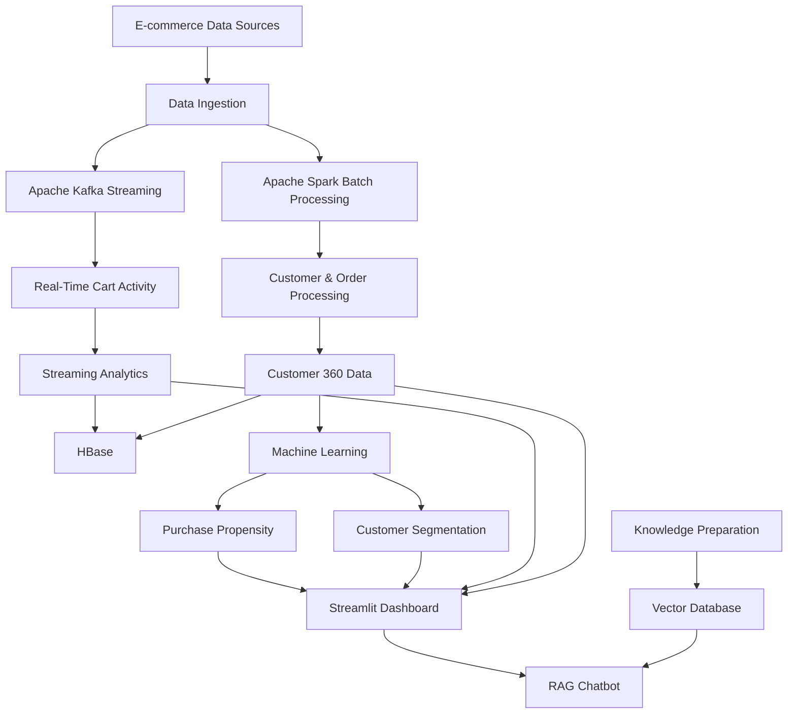

# 🛍️ Ecommerce Customer 360
### 🚀 End-to-End Data Engineering | Real-Time Analytics | Machine Learning | AI-Powered Customer Intelligence

<p align="center">
  <strong>Transforming raw e-commerce data into actionable customer insights.</strong>
</p>

<p align="center">
  
  
  
  
  
  
</p>

---

## 🌟 Overview

**Ecommerce Customer 360** is an end-to-end data engineering and analytics project designed to transform e-commerce data into meaningful customer intelligence.

The project brings together batch processing, real-time event streaming, customer data integration, machine learning, and AI-powered question answering to create a unified customer analytics platform.

Instead of analyzing customer information in isolated systems, this project combines customer profiles, orders, products, purchase behavior, and cart activity to provide a more comprehensive view of the customer journey.

From processing raw transactional data to predicting customer behavior and exploring insights through an interactive dashboard, the platform demonstrates how modern data engineering and AI technologies can work together in an e-commerce environment.

### 🎯 Project Objectives

- Build an end-to-end data pipeline for e-commerce analytics.
- Integrate customer, order, product, and activity data.
- Process batch data using Apache Spark.
- Capture and process real-time cart activity using Apache Kafka.
- Orchestrate data workflows using Apache Airflow.
- Maintain customer information using HBase.
- Develop machine learning models for customer segmentation and purchase propensity.
- Build an interactive Customer 360 dashboard using Streamlit.
- Enable AI-powered business question answering through a RAG chatbot.

---

## 🏗️ System Architecture

The platform combines batch data processing, streaming analytics, machine learning, and AI-driven customer intelligence.



> The architecture represents the major project components. Individual pipeline configurations and deployment details may vary.

---

## ⚙️ Technology Stack

| Category | Technologies |
|---|---|
| Programming | Python, SQL, Java |
| Batch Processing | Apache Spark, PySpark |
| Workflow Orchestration | Apache Airflow |
| Streaming | Apache Kafka, Spark Structured Streaming |
| Database | HBase |
| Machine Learning | Scikit-learn, Pandas, NumPy |
| AI / RAG | LangChain, Hugging Face Embeddings, ChromaDB, Groq |
| Dashboard | Streamlit |
| Development Environment | Linux / Ubuntu, Git, Docker |

---

## ✨ Key Features

### 📊 1. Customer 360 Data Integration

Combines customer-related information from multiple e-commerce datasets to create a unified analytical view.

- Customer profile processing
- Order and product data integration
- Customer purchase history
- Customer activity analysis
- Customer-level analytics

### ⚡ 2. Batch Data Engineering

Processes structured e-commerce data through Spark-based batch workflows.

- Data ingestion and transformation
- Data cleaning and validation
- Customer and order processing
- Analytical table preparation
- SQL-based data modeling

### 🔄 3. Real-Time Streaming Analytics

Uses Kafka and Spark Structured Streaming to process customer cart activity.

- Kafka-based event ingestion
- Real-time cart activity processing
- Streaming transformations
- Window-based aggregation
- Abandoned cart analytics

### 🗄️ 4. HBase Customer Data Storage

Uses HBase to maintain customer-related and activity information.

- Customer profile storage
- Customer 360 data
- Cart activity events
- Customer information retrieval

### 🤖 5. Machine Learning

Develops predictive analytics workflows using customer and transactional data.

**Customer Segmentation**
- Analyze customer characteristics and purchasing behavior.
- Identify customer groups for analytical insights.

**Purchase Propensity**
- Build predictive workflows to estimate customer purchase likelihood.
- Prepare customer features for model training and evaluation.
- Support customer-level predictive analytics.

### 🧠 6. AI-Powered RAG Chatbot

Integrates retrieval-augmented generation to help users explore project knowledge through natural-language questions.

The chatbot workflow includes:

1. Prepare relevant knowledge documents.
2. Generate embeddings using Hugging Face.
3. Store and retrieve information through ChromaDB.
4. Retrieve relevant context for user questions.
5. Generate contextual responses using a Groq-powered language model.

This enables conversational exploration of customer analytics and project-related information.

### 📈 7. Interactive Customer 360 Dashboard

Built with Streamlit to provide an interactive interface for exploring customer intelligence.

Dashboard capabilities include:

- Customer analytics
- Customer segmentation
- Purchase propensity insights
- Cart activity analytics
- AI-powered chatbot interface

---

## 📂 Project Structure

```text
ecommerce-customer-360/
│
├── config/
│   └── Configuration files
│
├── dags/
│   ├── ecommerce_customer360_pipeline.py
│   └── ecommerce_customer360_validation.py
│
├── docs/
│   └── Project documentation
│
├── scripts/
│   ├── airflow_spark_batch.sh
│   ├── airflow_spark_preflight.sh
│   └── airflow_spark_preflight.sh
│
├── sql/
│   ├── create_customer360_tables.sql
│   ├── create_fact_and_date.sql
│   └── load_fact_orders.sql
│
├── src/
│   │
│   ├── batch/
│   │   └── process_olist.py
│   │
│   ├── dashboard/
│   │   └── app.py
│   │
│   ├── hbase/
│   │   ├── consume_cart_events.py
│   │   └── load_customer_profiles.py
│   │
│   ├── ml/
│   │   ├── customer_segmentation.py
│   │   ├── purchase_propensity.py
│   │   ├── purchase_propensity_baseline.py
│   │   └── purchase_propensity_improved_rf.py
│   │
│   ├── rag/
│   │   ├── app.py
│   │   ├── build_vectorstore.py
│   │   ├── prepare_knowledge.py
│   │   └── test_retrieval.py
│   │
│   └── streaming/
│       ├── cart_event_producer.py
│       ├── cart_events_stream.py
│       ├── cart_window_aggregation.py
│       ├── cart_abandoned_alerts.py
│       └── cart_abandoned_alerts_v2.py
│
├── tests/
│   └── Project tests
│
├── .gitignore
└── README.md
```

---

## 🚀 Getting Started

### Prerequisites

Install or configure the following tools:

- Python
- Java
- Apache Spark
- Apache Kafka
- Apache Airflow
- HBase
- Git

Some components require their own configuration and runtime services.

### 1. Clone the Repository

```bash
git clone https://github.com/Ranjeetkumariiitbh/ecommerce-customer-360.git

cd ecommerce-customer-360
```

### 2. Create a Python Virtual Environment

```bash
python3 -m venv .venv
```

Activate it on Linux / Ubuntu:

```bash
source .venv/bin/activate
```

### 3. Install Dependencies

Install the required Python packages for the component you want to run.

```bash
pip install pandas numpy scikit-learn streamlit
```

Additional dependencies are required for Spark, Kafka, HBase, and the RAG chatbot.

> For a reproducible installation, use the project's dependency file if one is provided. The complete dependency configuration is still being organized.

### 4. Configure Environment Variables

Create a local `.env` file for credentials and configuration required by the AI chatbot.

Example:

```env
GROQ_API_KEY=your_groq_api_key
```

Never commit your actual API keys or credentials to GitHub.

### 5. Run the Dashboard

```bash
streamlit run src/dashboard/app.py
```

### 6. Run the RAG Chatbot

```bash
streamlit run src/rag/app.py
```

The chatbot requires its knowledge preparation and vector-store setup to be completed first.

### 7. Run Individual Pipeline Components

Batch processing, streaming, machine learning, and HBase components can be executed independently using their respective scripts and configurations.

Refer to the source files and project configuration for the required services and execution parameters.

---

## 🔍 Project Workflow

### Batch Processing

```text
Raw E-commerce Data
        ↓
Data Ingestion
        ↓
Spark Processing
        ↓
Data Cleaning & Transformation
        ↓
Customer / Order Analytics
        ↓
Customer 360 Data
```

### Real-Time Streaming

```text
Cart Activity
      ↓
Kafka Producer
      ↓
Kafka Topic
      ↓
Spark Structured Streaming
      ↓
Event Processing
      ↓
Window Aggregation
      ↓
Cart Analytics / Alerts
```

### Machine Learning

```text
Customer & Transaction Data
          ↓
Feature Preparation
          ↓
Model Training
          ↓
Model Evaluation
          ↓
Customer Segmentation
          ↓
Purchase Propensity
```

### RAG Chatbot

```text
Knowledge Documents
        ↓
Knowledge Preparation
        ↓
Embedding Generation
        ↓
ChromaDB
        ↓
User Question
        ↓
Context Retrieval
        ↓
Groq LLM
        ↓
Contextual Answer
```

---

## 💡 Business Use Cases

This project demonstrates how customer intelligence can support:

- Understanding customer purchase behavior
- Identifying customer segments
- Analyzing order and product trends
- Exploring cart activity
- Supporting purchase propensity analysis
- Building customer-centric analytics
- Exploring business information using conversational AI

---

## 🛠️ Future Enhancements

- Cloud-based data lake integration
- Automated CI/CD workflows
- Production-ready pipeline monitoring
- Advanced customer lifetime value modeling
- Improved recommendation systems
- More comprehensive model evaluation
- Scalable deployment of dashboard and chatbot
- Enhanced data quality monitoring

---

## 👨‍💻 Contributors

Developed as an end-to-end e-commerce data engineering and analytics project.

**Repository:**  
[Ranjeetkumariiitbh/ecommerce-customer-360](https://github.com/Ranjeetkumariiitbh/ecommerce-customer-360)

Contributions, feedback, and suggestions are welcome.

---

## ⭐ Support

If you find this project interesting, consider giving the repository a ⭐ on GitHub.

---

<p align="center">
  <strong>Turning E-commerce Data into Customer Intelligence 🚀</strong>
</p>
